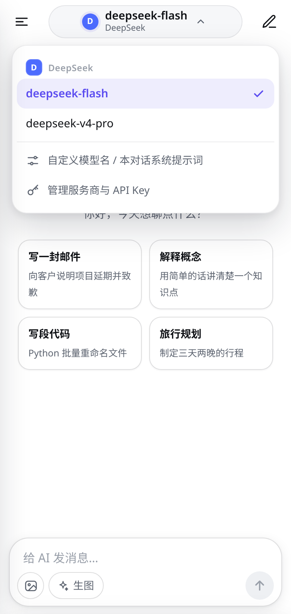
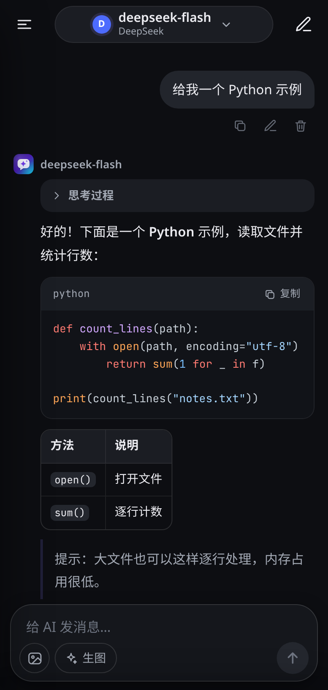
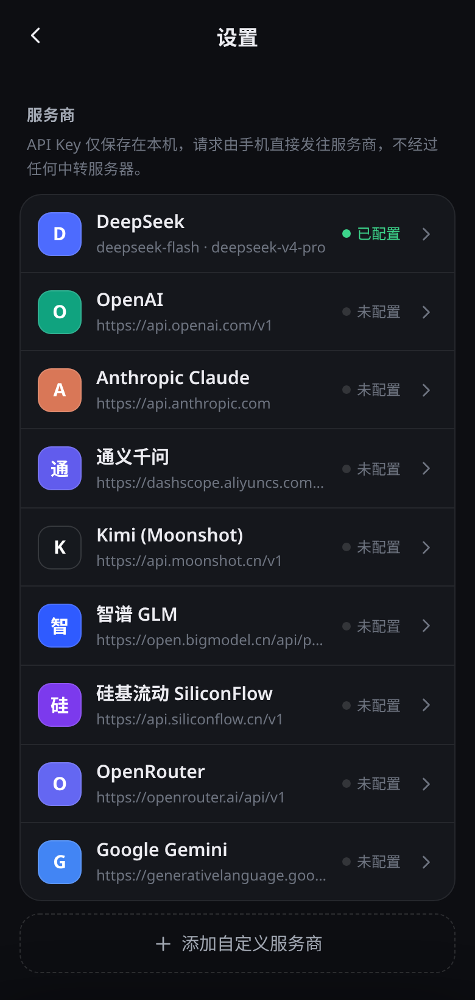

# AI Chat（Android）

一个**无后端**的多服务商 AI 聊天 Android 应用：你自己填写各家 API Key，Key 只保存在手机本地，请求由手机原生网络层直接发往服务商（无 CORS 问题，不经过任何中转服务器）。

<p>

</p>
<p>




</p>

## 功能

**v0.1.1 新增**：应用改名为 AI Chat、全新图标与界面设计（浅色/深色）、顶部模型胶囊一键切换、各家预设更新为当前模型名、「从接口获取模型列表」、旧版设置自动迁移（DeepSeek 已下线的 `deepseek-chat` / `deepseek-reasoner` 自动换成 `deepseek-flash`，API Key 与对话不受影响）。

- 聊天气泡界面，Markdown 渲染（代码块高亮 + 一键复制、表格、列表等）
- **流式输出**（SSE），随时**停止生成**
- 消息操作：复制、编辑并重发、重新生成、删除
- 推理模型的「思考过程」折叠显示（DeepSeek-R1 / reasoner 等的 `reasoning_content`）
- 多对话：新建、切换、重命名、删除，全部保存在本机
- 顶部「模型胶囊」：点一下弹出已配置服务商的模型列表，一键切换；也可自定义模型名和本对话系统提示词
- 服务商设置里可「从接口获取模型列表」（OpenAI 兼容 `GET /models`、Claude `/v1/models`、Gemini `models`），勾选后添加
- 服务商：
  - **OpenAI 兼容**（自定义 Base URL + Key + 模型），预设：OpenAI、DeepSeek、通义千问（DashScope 兼容模式）、Moonshot/Kimi、智谱 GLM、硅基流动 SiliconFlow、OpenRouter
  - **Anthropic Claude**（原生 Messages API）
  - **Google Gemini**（原生 generateContent API）
  - 可添加任意多个自定义服务商
- 图片输入（视觉模型）：点输入框左侧图片按钮添加，自动压缩
- 图片生成：点输入框里的「生图」切换模式，调用 OpenAI 兼容 `/images/generations`（如 OpenAI `gpt-image-2.5-flare`、智谱 `cogview-3-flash`、硅基流动 `Kwai-Kolors/Kolors`），可保存到相册
- 通用设置：默认系统提示词、流式开关、temperature、最大输出 tokens、生图尺寸
- 自动跟随系统深色模式

## 安装

1. 从 [Releases](../../releases) 下载 `AI-Chat.apk` 到手机（已安装旧版可直接覆盖安装，数据保留）。
2. 点击安装；如提示「禁止安装未知来源应用」，按提示在系统设置中允许当前浏览器/文件管理器「安装未知应用」。
3. 要求 Android 7.0（API 24）及以上。

## 配置服务商

1. 打开应用 → 点「去设置」（或左上角菜单 → 设置 / API Key）。
2. 点选要用的服务商（如 DeepSeek），粘贴 API Key，确认 Base URL 和模型名后点「保存」。
3. 不确定模型名时，点「从接口获取模型列表」，勾选需要的模型后保存。
4. 返回聊天页，点顶部的模型胶囊即可切换模型。

Base URL 填到 `/v1` 这一级即可（程序自动拼接 `/chat/completions`）。常用地址：

| 服务商 | Base URL |
|---|---|
| OpenAI | `https://api.openai.com/v1` |
| DeepSeek | `https://api.deepseek.com` |
| 通义千问 | `https://dashscope.aliyuncs.com/compatible-mode/v1`（或业务空间专属域名 `https://{WorkspaceId}.cn-beijing.maas.aliyuncs.com/compatible-mode/v1`） |
| Moonshot | `https://api.moonshot.cn/v1` |
| 智谱 GLM | `https://open.bigmodel.cn/api/paas/v4` |
| 硅基流动 | `https://api.siliconflow.cn/v1` |
| OpenRouter | `https://openrouter.ai/api/v1` |
| Claude | `https://api.anthropic.com` |
| Gemini | `https://generativelanguage.googleapis.com/v1beta` |

预设模型（2026-10 对照官方文档）：

| 服务商 | 预设模型 |
|---|---|
| OpenAI | gpt-6-astra、gpt-6.1-sol、gpt-6-luna；生图 gpt-image-2.5-flare |
| DeepSeek | deepseek-flash、deepseek-v4-pro |
| 通义千问 | qwen3.8-max、qwen3.8-flash、qwen3.7-plus |
| Kimi | kimi-k3、kimi-k2.6、kimi-k2.7-code |
| 智谱 GLM | glm-5.3、glm-5.3-flash、glm-4.7-flash；生图 cogview-3-flash |
| 硅基流动 | deepseek-ai/DeepSeek-V3.2、Qwen/Qwen3.5-397B-A17B、Qwen/Qwen3-32B；生图 Kwai-Kolors/Kolors |
| OpenRouter | openai/gpt-6-astra、anthropic/claude-opus-5.5、google/gemini-3.8-flash |
| Claude | claude-opus-5-5、claude-sonnet-5-5、claude-haiku-4-5、claude-fable-5-1 |
| Gemini | gemini-3.8-flash、gemini-3.1-pro-preview、gemini-3.5-flash-lite |

模型更新很快，以各家控制台为准；可随时编辑或用「从接口获取模型列表」刷新。

> 注意：OpenAI / Claude / Gemini 在中国大陆通常需要可用的网络环境才能访问。

## 技术实现

- 原生 Android（Java）外壳 + WebView 界面（`app/src/main/assets/www`），无第三方 Android 依赖
- 网络请求通过 `NativeBridge`（`HttpURLConnection`）在原生层发出，流式数据逐块回传给页面
- 数据（设置、对话）以 JSON 文件保存在应用私有目录，`allowBackup=false`
- 前端库（本地打包，离线可用）：marked、DOMPurify、highlight.js
- 各服务商请求构造 / SSE 解析在 `providers.js`（纯函数，带单元测试）

## 图标

图标源文件在 `design/`（SVG），用 `node design/render.js`（需 puppeteer-core 与本机 Chrome）渲染出各密度的 mipmap PNG（自适应图标前景/背景/单色层 + 传统图标）。

## 构建

需要 JDK 17 与 Android SDK（platform 34、build-tools 34）。

```bash
echo "sdk.dir=$HOME/Android/Sdk" > local.properties
./gradlew assembleRelease        # 输出 app/build/outputs/apk/release/app-release.apk
```

签名：若根目录存在 `keystore.properties`（不提交到 Git），用其中的证书签名 release；否则回退为 debug 证书。格式：

```properties
storeFile=keystore/release.jks
storePassword=******
keyAlias=aichat
keyPassword=******
```

> 用不同证书签名的 APK 不能覆盖安装，需先卸载旧版本（会清除本地数据）。

## 测试

```bash
npm test          # providers.js 单元测试（请求格式、SSE 解析、错误/生图解析），无需真实 Key
npm i && npm run test:ui   # 可选：用本机 Chrome 跑界面端到端测试（模拟原生桥，不访问网络；含旧版数据迁移；截图输出到 docs/）
```
