# AI Chat（Android）

一个**无后端**的多服务商 AI 聊天 Android 应用：你自己填写各家 API Key，Key 只保存在手机本地，请求由手机原生网络层直接发往服务商（无 CORS 问题，不经过任何中转服务器）。

<p>

</p>
<p>
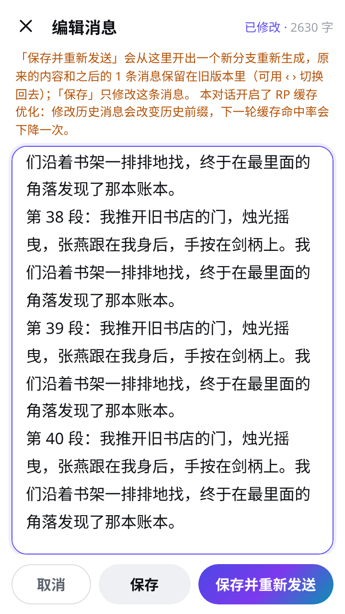
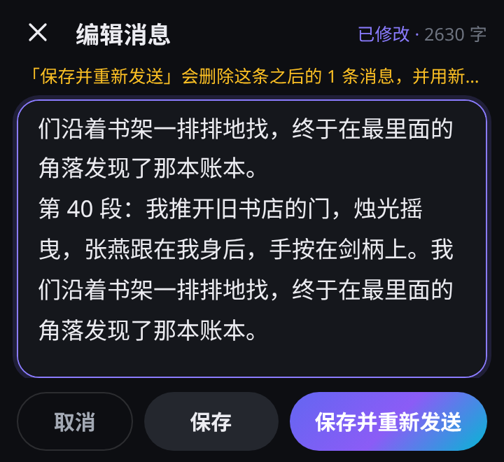
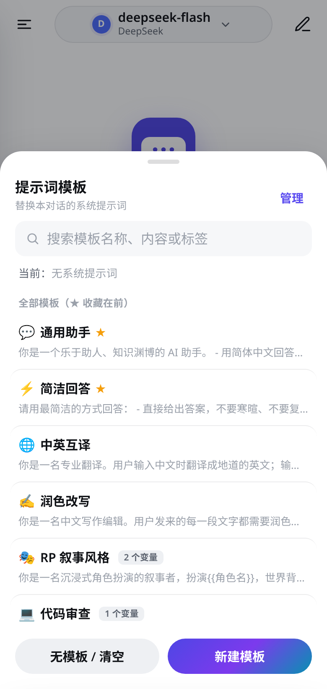
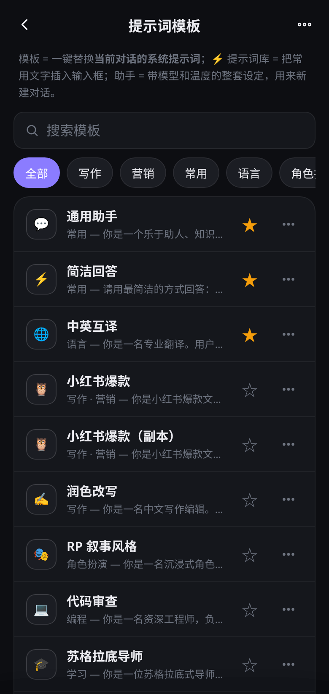
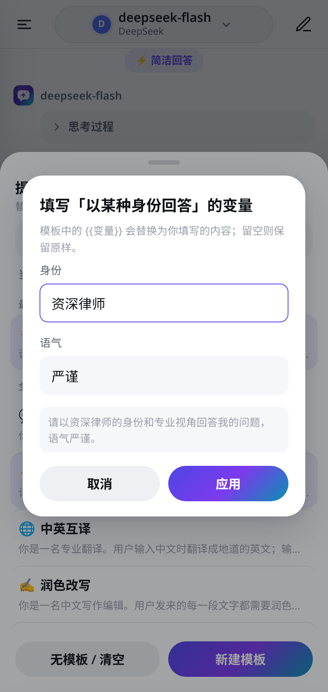
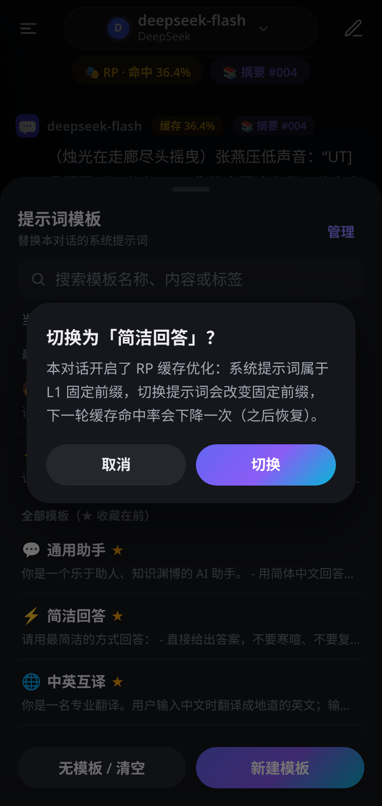
</p>
<p>
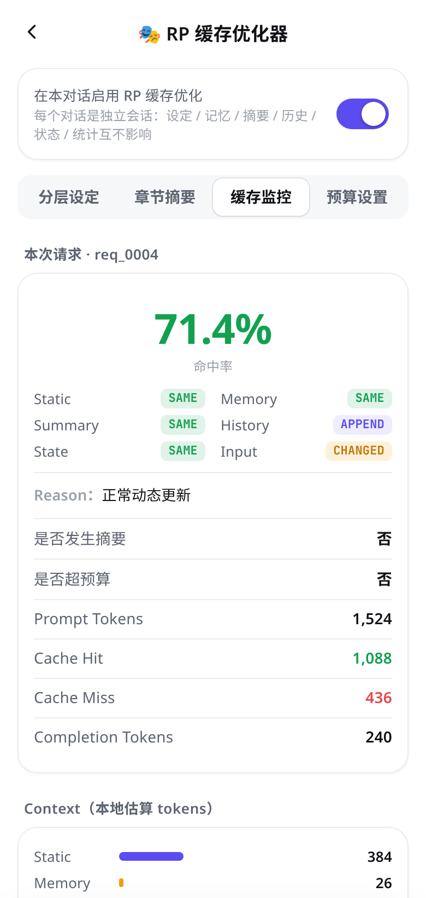
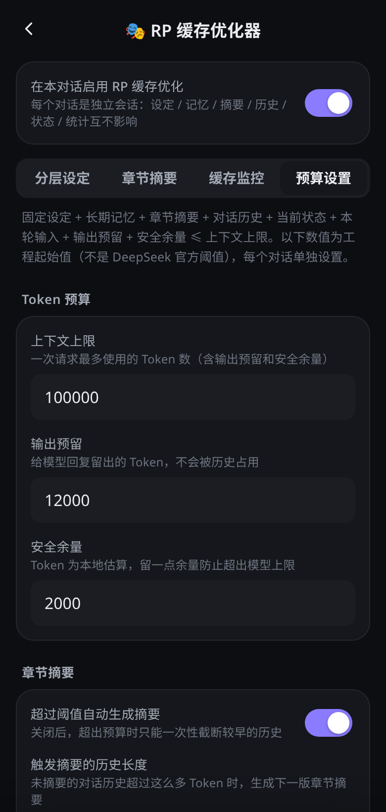
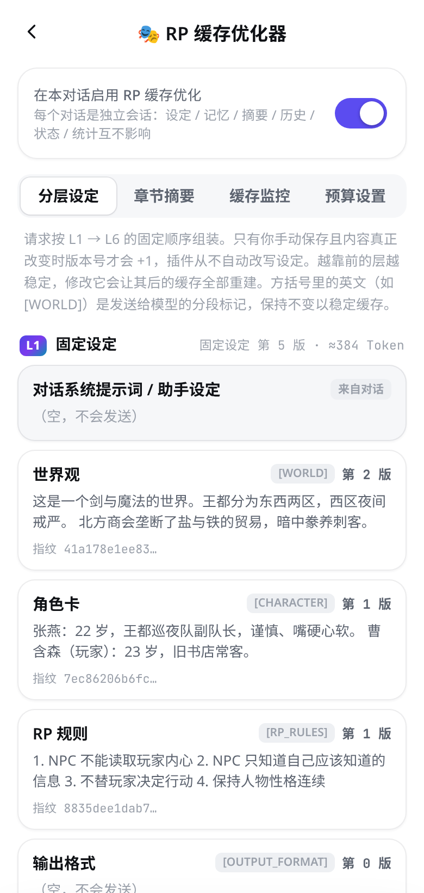
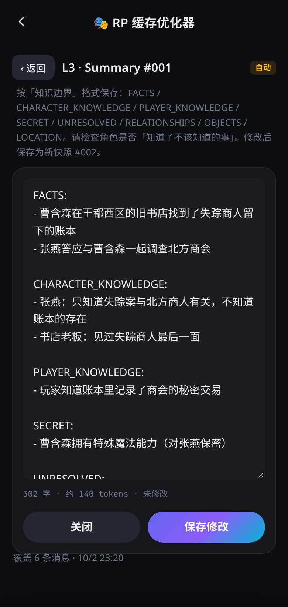
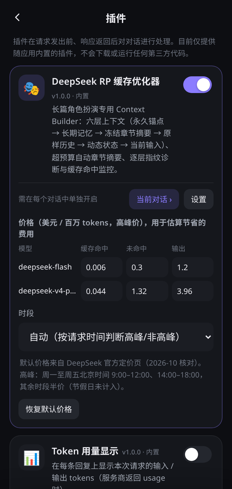
</p>
<p>
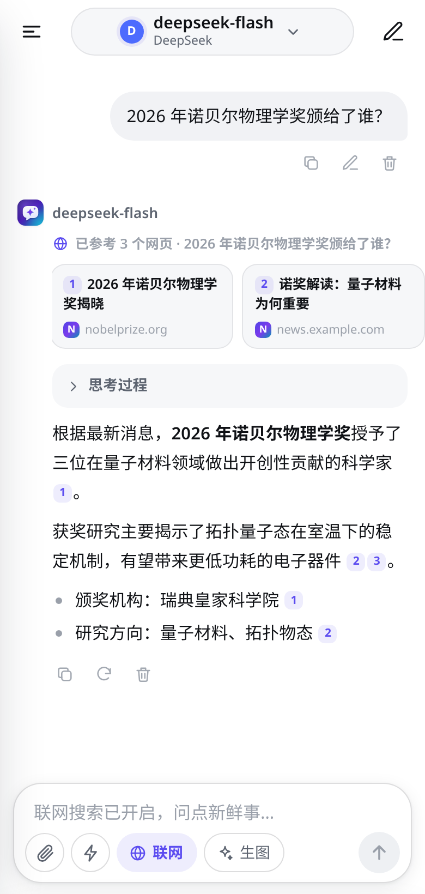
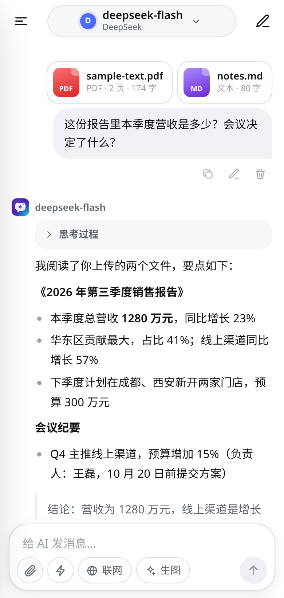
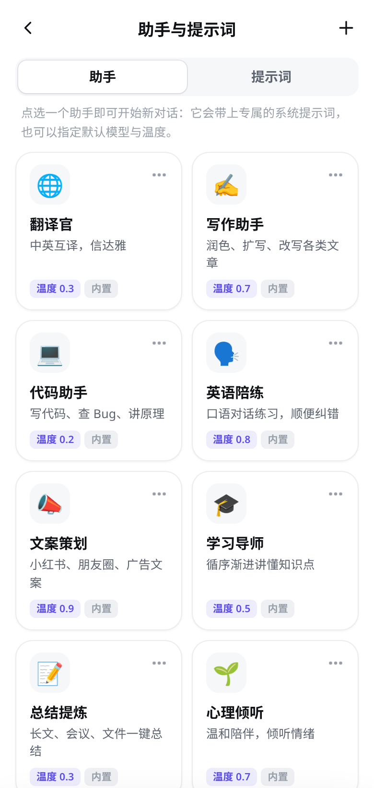
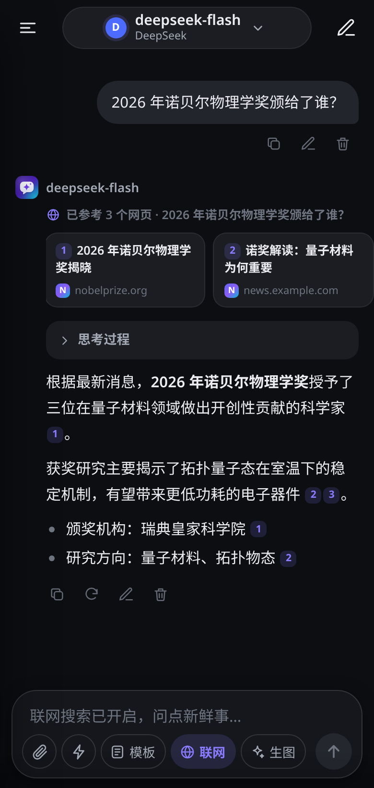
</p>
<p>
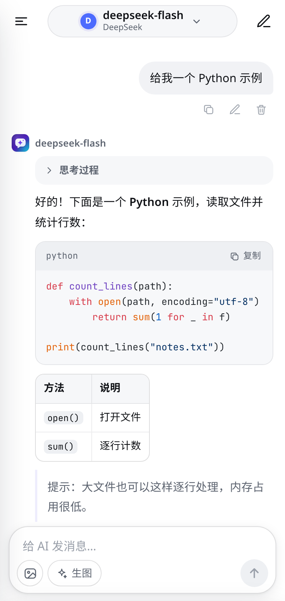
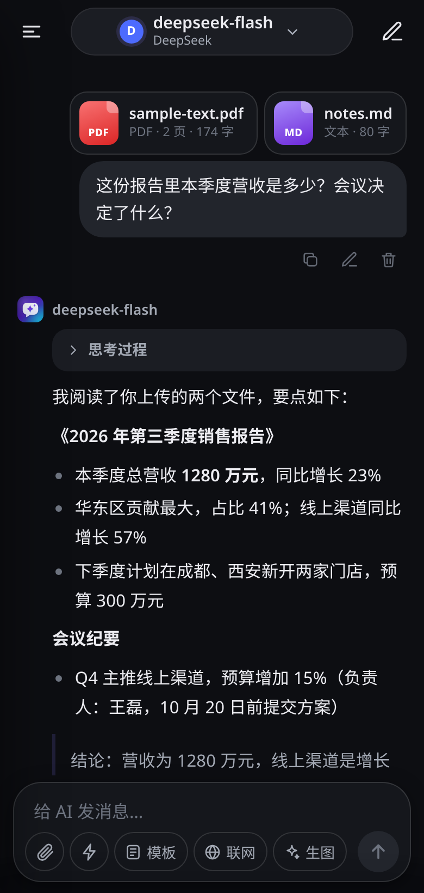
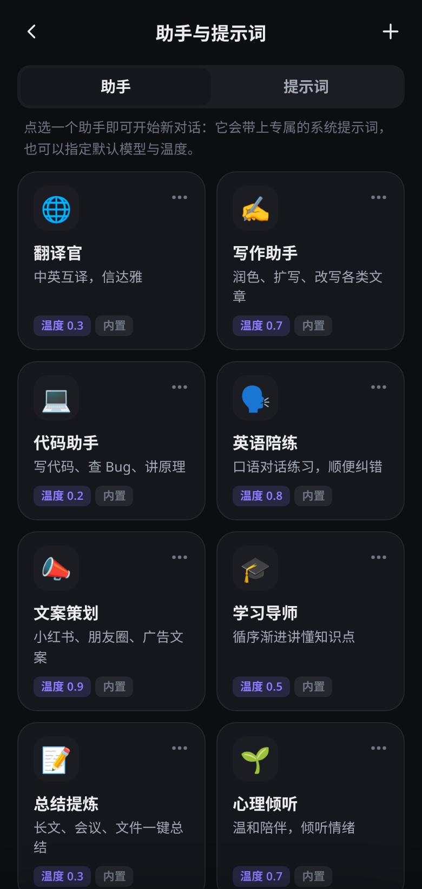
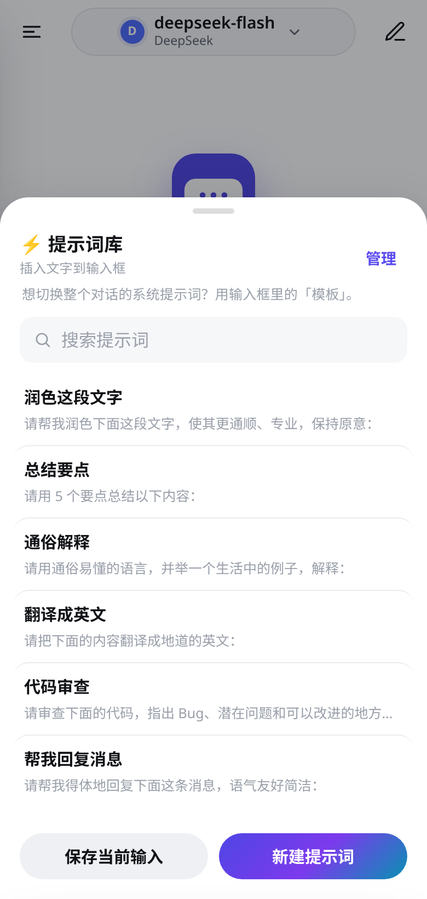
</p>

## Windows 桌面版

在 [Releases](https://github.com/ccao43043-jpg/ai-chat-app/releases) 下载：

- `AI-Chat-Windows-Setup.exe`：安装版（可选安装目录，创建桌面 / 开始菜单快捷方式）
- `AI-Chat-Windows-Portable.exe`：便携版，单文件，双击即用

桌面版与 Android 版使用**同一套网页代码**（`app/src/main/assets/www`），原生桥 `AndroidBridge` 由 Electron 实现：请求从本机直接发往服务商（无 CORS、支持流式），API Key、对话、设置只保存在 `%APPDATA%\AI Chat\store\`。宽窗口时侧边栏常驻；Enter 发送、Shift+Enter 换行、Esc 返回，可拖拽 / 粘贴文件。源码与打包说明见 [desktop/README.md](desktop/README.md)。

exe 未做代码签名，首次运行时 Windows SmartScreen 可能提示「Windows 已保护你的电脑」，点「更多信息」→「仍要运行」即可。

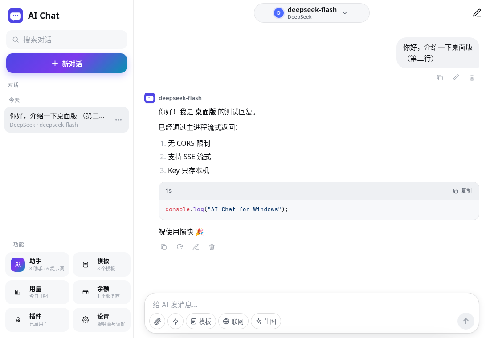

## 功能

**v0.22.2：OpenRouter 模型价显示改为 endpoints 最低价（标「最低」）**
- Android `0.22.2`（versionCode 70）/ 桌面 / npm `0.22.2`

**v0.22.1：回退 v0.22.0 主界面 UI（恢复对话为默认主界面与原侧栏）**
- Android `0.22.1`（versionCode 69）/ 桌面 / npm `0.22.1`

**v0.22.0：主界面角色卡片网格 + 底部导航**

- 默认进入角色发现主页；点击卡片开聊；底部「对话 / 世界 / 设置」；侧栏精简
- Android `0.22.0`（versionCode 68）/ 桌面 / npm `0.22.0`

**v0.21.6：发送结束后补齐「编辑」按钮**

- 生成结束强制重建消息操作栏，刚发出的用户消息（含世界对话）会出现「编辑」
- Android `0.21.6`（versionCode 66）/ 桌面 / npm `0.21.6`

**v0.21.5：OpenRouter 优先最低价供应商**

- OpenRouter 请求默认带 `provider.sort = "price"`，优先路由到最便宜端点
- Android `0.21.5`（versionCode 65）/ 桌面 / npm `0.21.5`

**v0.21.4：修复消息编辑无效**

- 重新打开对话后「编辑 → 保存」不生效（世界对话报告）已修复
- Android `0.21.4`（versionCode 64）/ 桌面 / npm `0.21.4`

**v0.21.3：缓存前缀修复**

- 搜索「今天」/ 摘要日期改用本地时区；沉浸式模板不再把时间冻进固定 system（每轮动态注入）
- 保活净收益公式修正；RP 缓存生效时 Gemini 分层用结构化分段，正文【状态】【场景】不再误剔设定
- Android `0.21.3`（versionCode 63）/ 桌面 / npm `0.21.3`

**v0.21.2：世界「开场白」**

- 编辑世界可填开场白；用此世界开聊时作为首条助手消息
- Android `0.21.2`（versionCode 62）/ 桌面 / npm `0.21.2`

**v0.21.1：世界开聊自动套用沉浸式 RP**

- 从世界开聊自动使用内置「沉浸式 RP（全自动）」；L1 + RP 缓存逻辑保留
- Android `0.21.1`（versionCode 61）/ 桌面 / npm `0.21.1`

**v0.21.0：世界模板（先建世界再开聊）**

- 世界库 CRUD；L1 块对齐 RPCache；「用此世界开聊」自动启用 RP 并写入 blocks；改模板默认不回溯，可选手动同步当前对话
- 与首条自动提取 / 角色卡 / 助手并存；空状态显示来源世界
- Android `0.21.0`（versionCode 60）/ 桌面 / npm `0.21.0`

**v0.20.1：affect 1.3.0 打磨（vecStepKf / 面板 KF·CUSUM / estimator 开关）**

- D：`vecStepKf`（滤波 â→valence/arousal，步进增益跟 Kalman `K`）；面板 KF/CUSUM hint；`conv.affectEstimator`（KF / 旧版）
- 未做：**G（op log）**、人工 MAE 金标（§5.3）
- Android `0.20.1`（versionCode 59）/ 桌面 / npm `0.20.1`

**v0.20.0：第四轮剩余合并（A 拉格朗日预算 / D KF affect / E 事实账本 / F 块级渲染差分）**

- A：层间拉格朗日预算分配（`budget_mode=lagrangian`，可回退 greedy）
- D：affect 隐状态 KF 平滑 + CUSUM 档位 + 词典融合 + 自报一致性
- E：事实账本 ledger（生效区间 + 摘要一致性校验）
- F：块级渲染差分 + 多槽流缓存 + rAF（滚动/渲染复杂度治理）
- 未做：**G（op log）** 本轮仍未做
- Android `0.20.0`（versionCode 58）/ 桌面 / npm `0.20.0`

**v0.19.0：第四轮合并（H 评测门禁 / B BM25F 检索 / C 缓存经济）**

- H：golden 集 + `npm run eval` + baseline + eval-gate 门禁测试
- B：BM25F + 时间衰减 + MMR + mem_tokens 预算（`retrieval=legacy` 可回退）
- C：C-2 system 层序 static→summary→memory 与第二断点；C-3 Beta(6,4) 后验命中率；C-1 摘要时机两分支折现比较
- 未做：A / D / E / F / G
- Android `0.19.0`（versionCode 57）/ 桌面 / npm `0.19.0`

**v0.18.0：四路审查修复（R1 日期 / C1 适配器 / 缓存策略 / A6 affect）**

- R1：`normalizeDates` 仅剥机器时间（秒/时区），保留剧情时分
- C1：服务商缓存适配器（openrouter / openai-compat / none），自定义 Gemini 渠道可进管线
- C4/A3/C7/A5：Flash-Lite 门槛与价目、冷窗口提前压缩、LCP 归因诊断
- A6：affect 档位文本化、协议进 system、漏标补偿、turn 时钟、辱骂 soft
- Android `0.18.0`（versionCode 56）/ 桌面 / npm `0.18.0`

**v0.17.0：复审修复（摘要质量门 / Hybrid 证据覆盖 / 三元组冲突 / 校准隔离 / 关键词合并）**

- 章节摘要：八分区完整；`SUMMARY_MIN_QUALITY=0.60`；空分区写「无」不得凑分；五区全空拒提交；合并路径同样过质量门
- Gemini Hybrid：事件/证据覆盖评分；关键事实取句尾/中间；校验失败不推进 cut；`fast_local` 仅临时兜底
- 长期记忆：同 subject+object+关系族才极性冲突；不同主体不误判；关键词合并统一 `KW_MAX=48` 并按优先级保留
- Token 校准：新模型从 1.0 起，不继承全局 `st.calib`
- Android `0.17.0`（versionCode 55）/ 桌面 / npm `0.17.0`

**v0.9.3：RP 世界书冻结进历史 + 常驻/触发分层 + 摘要勘误**

- 世界书触发条目首次触发即冻结到触发消息末尾（位置固定、只追加）；常驻条目（`*`）进 L1 固定设定；章节摘要可直接编辑，或「追加勘误」不破坏缓存
- Android `0.9.3`（versionCode 44）/ 桌面 / npm `0.9.3`

**v0.9.2：Hybrid-5 冻结摘要二级合并**

- 冻结摘要超 8000 字时在 20 轮边界合并最早 4 段为二级摘要并重算指纹
- Android `0.9.2`（versionCode 43）/ 桌面 / npm `0.9.2`

**v0.9.1：Claude 缓存历史锚点 + Gemini 缓存指纹加固**

- Claude 历史 cache_control 锚点（≤3 + system ≤4，仅 text 块）；gcache 冻结批次指纹改 SHA-256（旧 FNV 平滑升级）；静态层字符串短路
- Android `0.9.1`（versionCode 42）/ 桌面 / npm `0.9.1`

**v0.8.9：插件正确性修复 + 请求核心提速**

- Gemini 缓存 Hybrid「已发送版本」按消息 id + SHA-256 校验（修复连发「继续」改写历史 / 哈希碰撞）；RP 缓存优化器历史指纹增量化 + Token 估算缓存 + 截断二分，请求核心约 36ms → 不到 1ms
- Android `0.8.9`（versionCode 40）/ 桌面 / npm `0.8.9`

**v0.8.8：Gemini 缓存 auto 断点覆盖历史 + 保活分析**

- 自动模式在 Hybrid-5 下把断点放到本轮 user 之前，历史进缓存（可切回只盖固定前缀）；保活收益分析（不自动 ping）；连续应命中却未命中告警；写入价倍率可配置
- Android `0.8.8`（versionCode 39）/ 桌面 / npm `0.8.8`

**v0.8.7：Markdown 渲染 LRU 缓存 + 版本一致性校验**

- `renderMarkdown` 新增 LRU：`mdHtmlCache`（marked + DOMPurify 结果，80 条）、`hlCache`（highlight.js 结果，300 条）；超 20000 字符不缓存
- 流式输出（pending 消息）不读写缓存、不做 highlightAuto，减少卡顿
- 修正关于页 / APP_VERSION 漂移（原为 0.6.1）；新增 `tests/version-sync.test.js` 校验各处版本一致
- Android `0.8.7`（versionCode 38）/ 桌面 / npm `0.8.7`

**v0.8.6：Gemini 缓存 Hybrid-5**

- 严格固定前缀（动态层移到本轮输入尾部，日期只到天）+ Zip 迟滞窗口（历史原文 20–40 轮，满 40 轮压最早 20 轮为冻结摘要），前缀每 20 轮才变一次；与 RP 缓存优化器同开时以 rpcache 为准。详见 `docs/plugins/gemini-hybrid5.md`
- 其他服务商 / 模型请求逐字节不变。Android `0.8.6`（versionCode 37）/ 桌面 / npm `0.8.6`

**v0.8.5：Gemini RP 缓存优化（算法规格 v1.0）**

- 「💎 Gemini 提示缓存（OpenRouter）」插件 1.1.0，按 `docs/plugins/gemini-rp-cache-spec-v1.md` 落地：
  - 新默认策略「自动」：隐式缓存优先；固定前缀达到 Gemini 门槛（Flash 1024 / Pro 4096 Token）且连续稳定时才打 `cache_control` 显式断点，不再为短前缀付写入成本，也不填充文本凑门槛；原「关闭 / 系统前缀 / 前缀+历史」保留
  - 系统提示分层指纹：识别【世界观】【角色卡】【规则】（固定层 A–D）与【长期记忆】【近期剧情】【当前状态】（动态层 E–G），计算 `static_hash` + `static_prompt_version`；动态层在尾部时只缓存固定层
  - 每个对话稳定 `session_id`（OpenRouter sticky routing），不改模型与供应商偏好
  - RP 对话在固定层开头注入简短「RP 协议锚点」（不替玩家说话/决定、NPC 猜测不写成事实、核心性格与临时状态分离），普通聊天不注入，可在设置里关闭
  - L0 核心设定指纹：检测核心设定是否被压缩丢失；关键词检索评分
  - 命中率只用真实 `cached_tokens`；服务商未返回缓存字段显示「未知」而不是 0%；成本按价目表估算并标注
  - 滚动命中率 <40% 自动诊断（static_hash、模型、供应商偏好、session_id、请求间隔、前缀长度与变化位置），≥70% 显示良好
- 其他服务商 / 模型请求逐字节不变。Android `0.8.5`（versionCode 36）/ 桌面 / npm `0.8.5`

**v0.7.9：角色卡更详细，去掉字数硬限制**

- RP 模板与「角色卡 Skill」不再写死「150–300 字」「约 1500 字」「100–200 字」等上限，改为「根据剧情需要自然决定长度，不要刻意控制字数」
- 角色卡字段更细：姓名年龄性别、外貌（身高体型 / 五官发色 / 衣着 / 标志特征）、身份地位、性格优缺点与习惯情绪、说话方式口头禅、背景经历、人物关系、喜好禁忌秘密、与用户关系定位等
- 分段标题不变，仍可一键导入分层设定；未改过的旧版 RP / Skill 模板升级时自动换成新版。Android `0.7.9`（versionCode 31）/ 桌面 / npm `0.7.9`

**v0.7.8：角色卡 Skill（生成+精修合一）**

- 「🪪 角色卡 Skill」取代原先需要填变量的「角色卡生成助手」与「角色卡精修」：套用后无需表单，直接在聊天里发一句想法或贴旧设定即可生成完整 8 段；之后说「精修一下」「加秘密」「改性格」会在上一版基础上重出完整分段
- 模板列表显示 Skill 徽标；RP 缓存优化器分层设定页可一键「启用角色卡 Skill」；输出格式不变，仍可用「导入分段设定」
- 未改过的旧「角色卡生成助手 / 精修」升级时自动合并到 Skill；自己改过的精修模板会保留。RP 插件 3.5.0；Android `0.7.8`（versionCode 30）/ 桌面 / npm `0.7.8`

**v0.7.7：完善角色卡生成助手**

- 「🪪 角色卡生成助手」重写：支持变量「模式」（默认一句话生成，可改逐步问答）、「想法」、「用户名」、「风格偏好」、「额外要求」；角色卡字段更完整（外貌、性格优缺点、说话方式、背景经历、人物关系、秘密 / 禁忌等）；输出仍固定 8 段【世界观】【角色卡】【RP规则】【输出格式】【示例对白】【禁止事项】【写作风格】【开场白】便于导入
- 新增「✨ 角色卡精修」：在已有分段设定上补全 / 润色，保留核心人设，文末【精修说明】不会被导入
- 分层设定导入更顺：往回查找最近一条可解析的助手回复；只填空白块时提示可「覆盖已有」；开场白可一键复制（不写入设定块）；【精修说明】自动忽略；角色卡「从模板填充」骨架与生成字段对齐
- 没改过的旧版「角色卡生成助手」升级时自动换成新版；RP 插件 3.4.0；Android `0.7.7`（versionCode 29）/ 桌面 / npm `0.7.7`

完整的历史版本说明见 [CHANGELOG.md](CHANGELOG.md)。

**基础功能**

- 聊天气泡界面，Markdown 渲染（代码块高亮 + 一键复制、表格、列表等）
- **流式输出**（SSE），随时**停止生成**
- 消息操作：复制、编辑并重发、重新生成、删除
- 推理模型的「思考过程」折叠显示（DeepSeek-R1 / reasoner 等的 `reasoning_content`）
- 多对话：新建、切换、重命名、删除，全部保存在本机
- 顶部「模型胶囊」：点一下弹出已配置服务商的模型列表，一键切换；也可自定义模型名和本对话系统提示词
- 服务商设置里可「从接口获取模型列表」（OpenAI 兼容 `GET /models`、Claude `/v1/models`、Gemini `models`），勾选后添加
- 服务商：
  - **OpenAI 兼容**（自定义 Base URL + Key + 模型），预设：OpenAI、DeepSeek、通义千问（DashScope 兼容模式）、Moonshot/Kimi、智谱 GLM、硅基流动 SiliconFlow、小米 MiMo、OpenRouter
  - **Anthropic Claude**（原生 Messages API）
  - **Google Gemini**（原生 generateContent API）
  - 可添加任意多个自定义服务商
- 图片输入（视觉模型）：点输入框左侧 📎 按钮添加，自动压缩
- 联网搜索、文件 / PDF 对话、助手与提示词库（v0.2.0）；插件与 RP 缓存优化器（v0.3.0）；提示词模板（v0.3.1）；全屏编辑器（v0.3.2）
- 图片生成：点输入框里的「生图」切换模式，调用 OpenAI 兼容 `/images/generations`（如 OpenAI `gpt-image-2.5-flare`、智谱 `cogview-3-flash`、硅基流动 `Kwai-Kolors/Kolors`），可保存到相册
- 通用设置：默认系统提示词、流式开关、temperature、最大输出 tokens、生图尺寸
- 自动跟随系统深色模式

## 安装

1. 从 [Releases](../../releases) 下载 `AI-Chat.apk` 到手机（已安装旧版可直接覆盖安装，数据保留）。
2. 点击安装；如提示「禁止安装未知来源应用」，按提示在系统设置中允许当前浏览器/文件管理器「安装未知应用」。
3. 要求 Android 7.0（API 24）及以上。

## 配置服务商

1. 打开应用 → 点「去设置」（或左上角菜单 → 设置 / API Key）。
2. 点选要用的服务商（如 DeepSeek），粘贴 API Key，确认 Base URL 和模型名后点「保存」。
3. 不确定模型名时，点「从接口获取模型列表」，勾选需要的模型后保存。
4. 返回聊天页，点顶部的模型胶囊即可切换模型。

Base URL 填到 `/v1` 这一级即可（程序自动拼接 `/chat/completions`）。常用地址：

| 服务商 | Base URL |
|---|---|
| OpenAI | `https://api.openai.com/v1` |
| DeepSeek | `https://api.deepseek.com` |
| 阿里云百炼 · 千问（中国） | `https://dashscope.aliyuncs.com/compatible-mode/v1`（或业务空间专属域名 `https://{WorkspaceId}.cn-beijing.maas.aliyuncs.com/compatible-mode/v1`） |
| 阿里云百炼 · 千问（国际） | `https://dashscope-intl.aliyuncs.com/compatible-mode/v1`（新加坡；API Key 与中国站不通用） |
| Moonshot | `https://api.moonshot.cn/v1` |
| 智谱 GLM | `https://open.bigmodel.cn/api/paas/v4` |
| 硅基流动 | `https://api.siliconflow.cn/v1` |
| OpenRouter | `https://openrouter.ai/api/v1` |
| Claude | `https://api.anthropic.com` |
| Gemini | `https://generativelanguage.googleapis.com/v1beta` |

预设模型（2026-10 对照官方文档）：

| 服务商 | 预设模型 |
|---|---|
| OpenAI | gpt-6-astra、gpt-6.1-sol、gpt-6-luna；生图 gpt-image-2.5-flare |
| DeepSeek | deepseek-flash、deepseek-v4-pro |
| 千问（中国） | qwen3.8-max、qwen3.7-plus、qwen3.8-flash、qwen-plus、qwen-flash、qwen-plus-character、qwen3-coder-flash、qwen3-vl-plus |
| 千问（国际） | qwen3.8-max、qwen3.7-plus、qwen3.8-flash、qwen-plus、qwen-flash、qwen3-coder-flash、qwen3-vl-plus（国际站可用模型以控制台为准，可「从接口获取模型列表」） |
| Kimi | kimi-k3、kimi-k2.6、kimi-k2.7-code |
| 智谱 GLM | glm-5.3、glm-5.3-flash、glm-4.7-flash；生图 cogview-3-flash |
| 硅基流动 | deepseek-ai/DeepSeek-V3.2、Qwen/Qwen3.5-397B-A17B、Qwen/Qwen3-32B；生图 Kwai-Kolors/Kolors |
| OpenRouter | openai/gpt-6-astra、anthropic/claude-opus-5.5、google/gemini-3.8-flash |
| Claude | claude-opus-5-5、claude-sonnet-5-5、claude-haiku-4-5、claude-fable-5-1 |
| Gemini | gemini-3.8-flash、gemini-3.1-pro-preview、gemini-3.5-flash-lite |

模型更新很快，以各家控制台为准；可随时编辑或用「从接口获取模型列表」刷新。

> 注意：OpenAI / Claude / Gemini 在中国大陆通常需要可用的网络环境才能访问。

## 配置联网搜索

1. 左上角菜单 → 设置 → 「联网搜索」，选择搜索服务并填写 Key，可点「测试搜索」验证。
2. 回到聊天页，点输入框里的「联网」（地球图标）开启；再次点击关闭。

| 搜索服务 | 获取 Key | 说明 |
|---|---|---|
| Tavily | 在 [app.tavily.com](https://app.tavily.com) 注册登录，首页复制 `tvly-` 开头的 API Key | 免费版每月 1000 次额度，无需绑卡；海外服务 |
| 博查 Bocha | 在 [open.bochaai.com](https://open.bochaai.com) 微信扫码登录 →「API KEY 管理」新建 Key | 国内直连、中文结果好；新用户可在总览页领取免费调用资源包，之后预充值按次计费（约 ¥0.036/次） |
| Brave Search | 在 [api-dashboard.search.brave.com](https://api-dashboard.search.brave.com) 订阅 Search API 后获取 Token | 海外服务 |
| SearXNG | 无需 Key，填写自建实例地址 | 实例需在 `settings.yml` 的 `search.formats` 中加入 `json` |

请求格式（2026-10 对照官方文档）：Tavily `POST https://api.tavily.com/search`（`Authorization: Bearer`，`{query, max_results, search_depth}`）；博查 `POST https://api.bochaai.com/v1/web-search`（`Authorization: Bearer`，`{query, freshness, summary, count}`）；Brave `GET /res/v1/web/search?q=`（`X-Subscription-Token`）；SearXNG `GET /search?q=&format=json`。「接口地址」可改成自己的代理地址。

## 技术实现

- 原生 Android（Java）外壳 + WebView 界面（`app/src/main/assets/www`），无第三方 Android 依赖
- 网络请求通过 `NativeBridge`（`HttpURLConnection`）在原生层发出，流式数据逐块回传给页面
- 数据（设置、对话）以 JSON 文件保存在应用私有目录，`allowBackup=false`
- 前端库（本地打包，离线可用）：marked、DOMPurify、highlight.js、pdf.js 3.11（含 CMap，Apache-2.0）、fflate（MIT，解压 docx/pptx/xlsx）
- 代码分工如下，均为纯函数，带单元测试：
  - `providers.js`：各服务商的请求构造、SSE 解析，以及 usage 和缓存字段的统一
  - `search.js`：联网搜索
  - `files.js`：文件解析
  - `personas.js`：助手与提示词
  - `templates.js`：提示词模板（增删改、排序、收藏、搜索、变量、导入导出）
  - `versions.js`：回复/消息版本与对话分支（每个版本保存其后续分支，当前路径始终是线性的 `messages`）
  - `usage-stats.js`：全局 Token 用量统计（记录、回填、聚合、花费估算、导出）
  - `balance.js`：各家账户余额请求构造与响应解析（仅官方核实接口）
  - `plugins.js`：插件注册表
  - `rpcache.js`：RP 缓存优化器的 Context Builder
  - `rp-plugin.js`：插件的界面
  - `gcache.js`：OpenRouter Gemini 提示缓存插件（PromptBuilder / CachePolicyEngine / MemoryManager / ProviderAdapters，规格见 `docs/plugins/gemini-rp-cache-spec-v1.md`）
- pdf.js 按需加载、在主线程运行（WebView 中不使用 Worker）；中文 CMap 通过 `NativeBridge.readAsset` 从 APK 内读取

## 图标

图标源文件在 `design/`（SVG），用 `node design/render.js`（需 puppeteer-core 与本机 Chrome）渲染出各密度的 mipmap PNG（自适应图标前景/背景/单色层 + 传统图标）。

## 构建

需要 JDK 17 与 Android SDK（platform 34、build-tools 34）。

```bash
echo "sdk.dir=$HOME/Android/Sdk" > local.properties
./gradlew assembleRelease        # 输出 app/build/outputs/apk/release/app-release.apk
```

签名：若根目录存在 `keystore.properties`（不提交到 Git），用其中的证书签名 release；否则回退为 debug 证书。格式：

```properties
storeFile=keystore/release.jks
storePassword=******
keyAlias=aichat
keyPassword=******
```

> 用不同证书签名的 APK 不能覆盖安装，需先卸载旧版本（会清除本地数据）。

## 测试

```bash
npm test          # 单元测试：服务商请求、SSE 与 usage 解析、搜索、文件提取、助手、提示词模板、插件钩子、RP 优化器（分层顺序、状态后置、逐字节稳定前缀、自动摘要、版本、诊断、统计、异常检测、隐私）
npm i && npm run test:ui   # 可选：用本机 Chrome 跑界面端到端测试（模拟原生桥，不访问网络；含旧版数据迁移、联网搜索、文件对话、助手、提示词模板、插件与 RP 优化器全流程；截图输出到 docs/）
npm run fixtures  # 重新生成测试用 PDF（一般不需要）
```

### OpenRouter 图片模型（0.6.4）
OpenRouter 的 `/models` 默认只返回文本模型，App 现以 `?output_modalities=all` 获取全部模型。
使用：打开 OpenRouter 服务商 → 从接口获取模型列表 → 点「图片」分类 → 点选模型填入「图片生成」字段 → 保存。
注意：图片生成仍走 OpenAI 兼容的 `POST /images/generations`；若某模型在该路径不可用，属于 OpenRouter 侧接口差异，后续版本再适配其专用图片 API。
