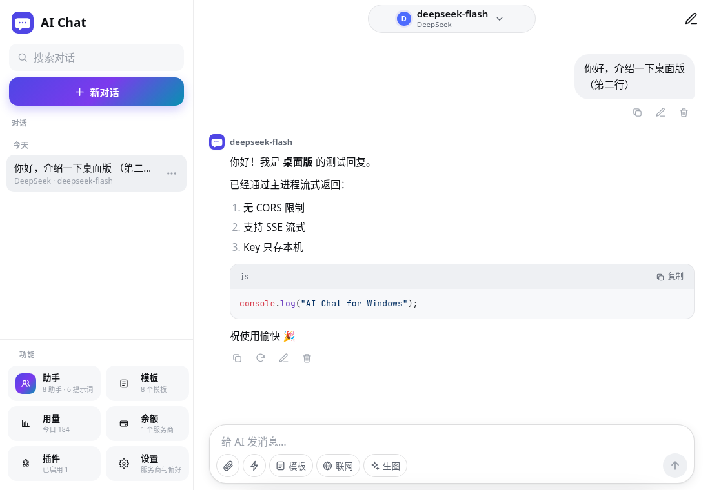

# AI Chat 桌面版（Windows）

Electron 外壳，**直接复用 Android 版的网页资源** `app/src/main/assets/www/`（构建 / 运行前由 `scripts/copy-web.js` 复制到 `desktop/web/`，该目录不入库），所以以后网页端的新功能会同时出现在 Android 和 Windows 上，不需要维护两份代码。



## 原理

Android 版通过 `addJavascriptInterface(bridge, "AndroidBridge")` 给网页提供原生能力。桌面版在 `src/preload.js` 里用同名对象 `window.AndroidBridge` 提供**相同的方法、参数和同步/异步语义**，由 `src/main.js`（主进程）实现：

| 方法 | Android（NativeBridge.java） | 桌面版 |
| --- | --- | --- |
| `request(id, method, url, headersJson, body, timeoutSec)` | 原生 HttpURLConnection，回调 `window.__nativeHttp.onStart/onChunk/onEnd/onError` | 主进程 `net.fetch`（Chromium 网络栈，跟随系统代理，无 CORS），逐块回调，支持 SSE 流式 |
| `cancel(id)` | 断开连接，回调 `onEnd` | 中止请求，回调 `onEnd` |
| `storeGet / storeSet / storeDelete`（同步） | 应用私有目录 `files/store/`，一键一文件，原子写入 | `%APPDATA%\AI Chat\store\`，同样一键一文件、原子写入（同步 IPC） |
| `copy(text)` | 系统剪贴板 | 系统剪贴板 |
| `openUrl(url)` | 系统浏览器（仅 http/https） | 默认浏览器（仅 http/https） |
| `readAsset(path)`（同步） | 读 `www/lib/cmaps/`，供 pdf.js 中文 CMap | 同上 |
| `toast(text)` | Android Toast | 页面内同款 toast |
| `saveImage(src)` | 保存到 图片/AIChat | 弹出「保存图片」对话框，默认 图片 文件夹 |

文件 / PDF / Word / Excel 解析本来就在网页里完成（pdf.js、fflate），桌面版通过系统文件对话框选择文件即可。

桌面版额外：
- 宽窗口（≥ 900px）侧边栏常驻、聊天区居中限宽；窄窗口自动回到手机布局。样式在 `src/desktop.css`，只在 `<html class="desktop">` 下生效，Android 不受影响。
- Enter 发送、Shift+Enter 换行（输入法组字时不触发）；Esc / 鼠标侧键 = 返回；拖拽或粘贴文件 = 添加附件；右键菜单（复制 / 粘贴 / 打开链接）；Ctrl + / Ctrl - / Ctrl 0 缩放；F12 开发者工具。
- 单实例运行；无菜单栏；窗口 1100×760，最小 420×560。
- 外部链接一律用默认浏览器打开；页面本身不能跳转到外部网址。

## 开发

```bash
cd desktop
npm install
npm start          # 复制网页资源并启动
npm test           # 端到端测试（mock SSE 服务器、桥接、存储、流式、截图）；Linux 无显示器时自动用 xvfb-run
```

## 打包 Windows

```bash
npm run dist:win   # dist/AI-Chat-Windows-Setup.exe（NSIS 安装包）+ dist/AI-Chat-Windows-Portable.exe（单文件便携版）
```

在 Linux 上打包需要 wine（含 32 位 `wine32:i386`，NSIS 卸载程序生成需要）。图标：`npm run icon`（`xvfb-run -a npx electron scripts/make-icon.js`）从 `app/src/main/assets/www/logo.svg` 重新生成 `resources/icon.ico` / `icon.png`。

exe 未做代码签名，首次运行 Windows SmartScreen 可能提示「已保护你的电脑」：点「更多信息」→「仍要运行」。

## 数据位置

- 安装版和便携版共用：`%APPDATA%\AI Chat\store\`（API Key、对话、设置都只在这里，卸载时不会删除）
- 可用环境变量 `AICHAT_USER_DATA` 指定其他数据目录
